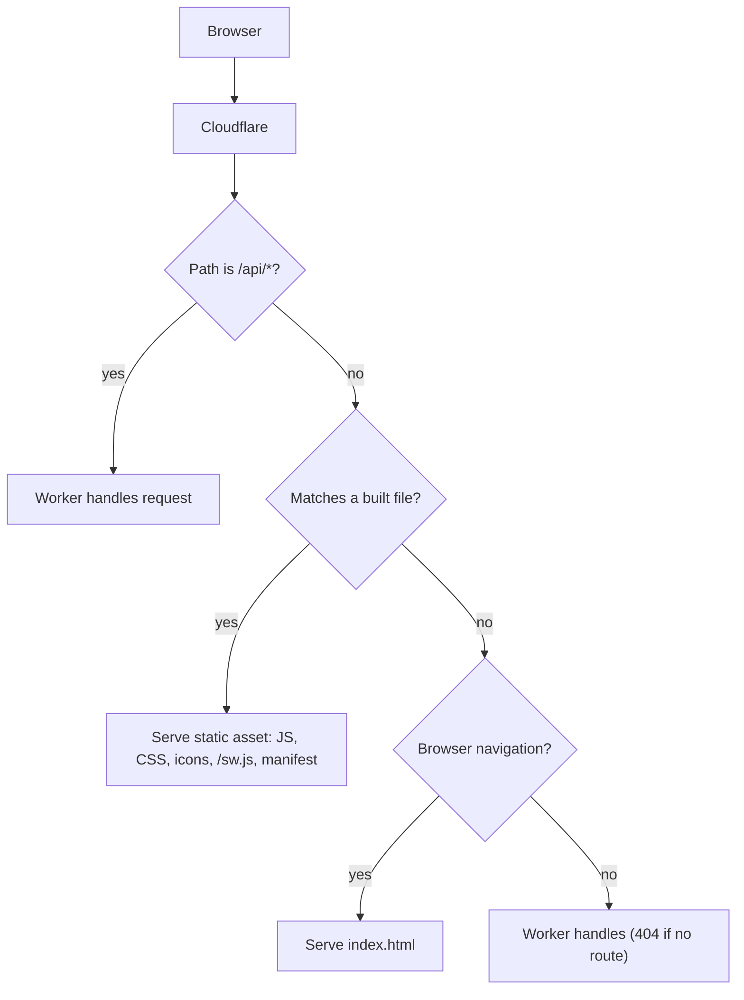
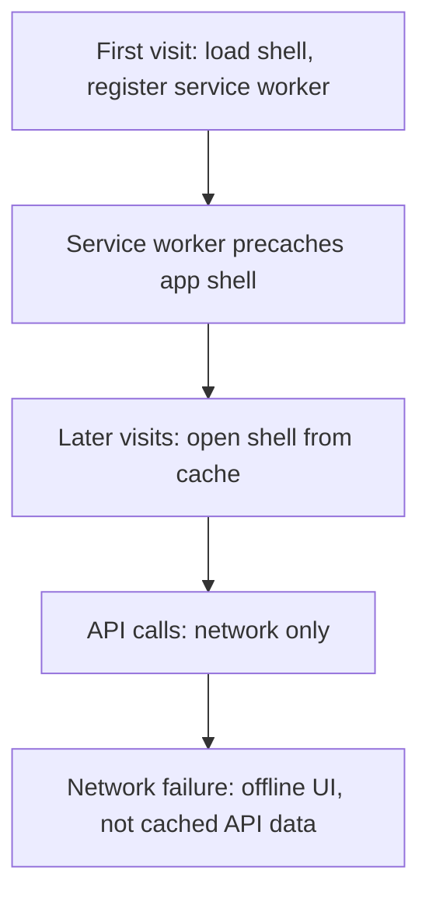
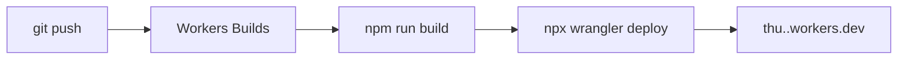

# thu

This file is the deployment contract for a React progressive web app built with Vite and TypeScript and deployed to Cloudflare Workers with Workers Static Assets. The app runs in the browser as an installable PWA; an optional Worker handles `/api/*` while static files and SPA routing are served from the asset pipeline. The product is described in [README.md](./README.md). Application source is already in `src/`, `worker/`, and `public/`.

Cloudflare Pages is for existing Pages projects only; new sites like this one use Workers with static assets.

## What you are deploying



A request hits Cloudflare at the edge. `run_worker_first` sends `/api/*` to the Worker before any asset lookup, so an API call never receives `index.html`. Anything else that matches a built file is returned as that file: hashed bundles, PWA icons, `/sw.js`, and `manifest.webmanifest`. A browser navigation that misses every file gets `index.html` and does not run the Worker. Any other miss runs the Worker, which returns 404 when it has no route.

## Stack

| Piece | Why |
| --- | --- |
| React | UI components and client-side routing for the SPA |
| Vite | Fast dev server and production bundling for the client |
| TypeScript | Typed application and Worker code |
| vite-plugin-pwa | Web app manifest, service worker, and offline shell via Workbox |
| Cloudflare Vite plugin (`@cloudflare/vite-plugin`) | Local dev and preview run in the Workers runtime (`workerd`) |
| Wrangler | Deploy and local secrets; config in `wrangler.jsonc` (preferred over TOML) |
| Workers Static Assets | Hosts the Vite client build at the edge with SPA fallback |
| Workers Builds | Cloudflare CI: build on push, deploy with Wrangler |

## Repository layout

```text
index.html
public/          # PWA icons and other static files copied into the client build
src/             # React application
worker/index.ts  # Optional API and Cloudflare bindings
vite.config.ts
wrangler.jsonc
package.json
INSTRUCTIONS.md
```

- `src/` holds the React UI. The browser cannot use Worker bindings directly; it calls the Worker with `fetch`.
- `worker/` holds the Worker entry and any `/api/*` handlers plus bindings (KV, D1, secrets, and so on).
- `public/` holds files such as 192 and 512 PWA icons that Vite copies unchanged into the build output.

## Prerequisites

- Node.js (current LTS)
- A Cloudflare account
- Wrangler authenticated once on your machine: `npx wrangler login`

## Scripts

| Command | What it does |
| --- | --- |
| `npm run dev` | `vite` — local dev with the Cloudflare Vite plugin (Workers runtime) |
| `npm run build` | `tsc -b && vite build` — client assets plus output `wrangler.json` |
| `npm run preview` | `vite preview` — production build inside the Workers runtime before deploy |
| `npm run deploy` | `npm run build && wrangler deploy` — uses build output `wrangler.json`, not source `wrangler.jsonc` |
| `npm test` | `vitest run` |
| `npm run lint` | `eslint .` |
| `npm run typecheck` | `tsc --noEmit` |
| `npm run check` | `npm test && npm run lint && npm run typecheck` |

```json
{
  "scripts": {
    "dev": "vite",
    "build": "tsc -b && vite build",
    "preview": "vite preview",
    "deploy": "npm run build && wrangler deploy",
    "test": "vitest run",
    "lint": "eslint .",
    "typecheck": "tsc --noEmit",
    "check": "npm test && npm run lint && npm run typecheck"
  }
}
```

## Configure Cloudflare

```jsonc
{
  "$schema": "./node_modules/wrangler/config-schema.json",
  "name": "thu",
  // Pin this. Advance it only when you mean to take the runtime changes.
  "compatibility_date": "2026-11-05",
  "main": "./worker/index.ts",
  "upload_source_maps": true,
  "assets": {
    "not_found_handling": "single-page-application",
    "run_worker_first": ["/api/*"]
  }
}
```

Do not set `assets.directory` in this project: the Cloudflare Vite plugin wires static assets to the client build output automatically. A Wrangler-only setup without the plugin would set `"directory": "./dist/"`; here the plugin owns that path.

With `not_found_handling` set to `"single-page-application"`, navigations that miss a file receive `index.html` for React Router (or similar) without invoking the Worker when the compatibility date is after 2025-04-01 (`assets_navigation_prefers_asset_serving`). Setting `run_worker_first` to `["/api/*"]` forces those URL patterns through the Worker regardless of asset rules.

Client `fetch("/api/...")` calls are not navigations, so they reach the Worker under normal routing as well. The React app never uses bindings directly—only the Worker does, and the client talks to it over HTTP. Deploy always uses the `wrangler.json` emitted by `vite build`, not this source `wrangler.jsonc`.

[https://developers.cloudflare.com/workers/framework-guides/web-apps/react/](https://developers.cloudflare.com/workers/framework-guides/web-apps/react/)

[https://developers.cloudflare.com/workers/static-assets/routing/single-page-application/](https://developers.cloudflare.com/workers/static-assets/routing/single-page-application/)

## Progressive web app



Configure `vite-plugin-pwa` (`VitePWA`) in `vite.config.ts` after `@vitejs/plugin-react` and before the Cloudflare plugin: `react()`, `VitePWA(...)`, then `cloudflare({ viteEnvironment: { name: "worker" } })`.

```ts
VitePWA({
  registerType: "autoUpdate",
  manifest: {
    name: "thu",
    short_name: "thu",
    display: "standalone",
    start_url: "/",
    scope: "/",
    theme_color: "#ffffff",
    background_color: "#ffffff",
    icons: [
      { src: "/pwa-192x192.png", sizes: "192x192", type: "image/png" },
      { src: "/pwa-512x512.png", sizes: "512x512", type: "image/png" },
      { src: "/pwa-512x512.png", sizes: "512x512", type: "image/png", purpose: "maskable" },
    ],
  },
  workbox: {
    globPatterns: ["**/*.{js,css,html,svg,png,ico,webmanifest}"],
    navigateFallback: "/index.html",
  },
})
```

Put icons under `public/` so they are real files in the client build. The service worker and `manifest.webmanifest` are emitted into that build; Cloudflare serves them as static assets. SPA fallback must not answer `/sw.js` or the manifest—if it does, those files failed to build.

Installability checklist:

- Valid manifest linked from `index.html` (the plugin injects the link)
- 192 and 512 icons present
- Service worker registered
- HTTPS (workers.dev or a custom domain)
- `/sw.js` and the manifest are real built files, not `index.html`

Test the installed PWA with `npm run preview` or the deployed URL, not `npm run dev`. Dev is for UI work; the service worker behavior matches production builds.

## Local development

1. Install dependencies: `npm install`
2. Start dev: `npm run dev`
3. Run quality gates: `npm run check`
4. Try production routing and PWA behavior: `npm run preview`

Preview runs the production build inside the Workers runtime and matches deploy-time routing more closely than dev.

Use preview when validating service worker registration, install prompts, and direct URL loads for client routes.

## Deploy



| Setting | Value |
| --- | --- |
| Build command | `npm run build` |
| Deploy command | `npx wrangler deploy` |

From a machine with Wrangler auth: `npm run deploy` (builds, then deploys using the generated `wrangler.json`).

A custom domain is optional and is attached as a Worker custom domain, not a Pages project: [https://developers.cloudflare.com/workers/configuration/routing/custom-domains/](https://developers.cloudflare.com/workers/configuration/routing/custom-domains/)

## Cache and offline behavior

Hashed JavaScript and CSS filenames can be cached immutably by the browser and Workbox precache. Long cache lifetimes are safe because the hash changes when the file content changes.

The service worker script and web manifest should revalidate so a new deploy can replace them and pick up `registerType: "autoUpdate"` behavior. The app shell (HTML, JS, CSS, icons) can load offline via precaching and `navigateFallback`.

`/api/*` is not in `globPatterns` and is not precached; API responses stay network-only. Do not configure Workbox to cache API responses. When offline, data screens should show an offline state instead of pretending stale API data is fresh.

## Secrets and local env

Local secrets belong in `.dev.vars` (gitignored). Deployed secrets are set with `npx wrangler secret put NAME` and are not stored in the repo. Never commit secret values. `.dev.vars` is for local development only and is not uploaded when you deploy.

Ensure `.gitignore` includes at least: `node_modules/`, `dist/`, `.wrangler`, `.dev.vars*`, `coverage/`, `.env`.

## Verify a deploy

- Open the `thu.<account>.workers.dev` URL over HTTPS
- Reload a deep client route directly; the response must be the app shell, not a 404 HTML page from the origin
- In DevTools Application: manifest parses, service worker is activated
- Install prompt or browser install flow works (manifest, icons, SW, HTTPS)
- Offline mode: shell still loads; API-backed views show offline handling
- `fetch` or open `/api/...` and confirm JSON from the Worker, not `index.html`

## How this repo is built

Application source, Worker handlers, and Vite configuration live in the paths above. A change is done only when `npm run check` passes.

For the planner-and-workers workflow, quality gates, and conventions, see [INSTRUCTIONS.md](./INSTRUCTIONS.md).
