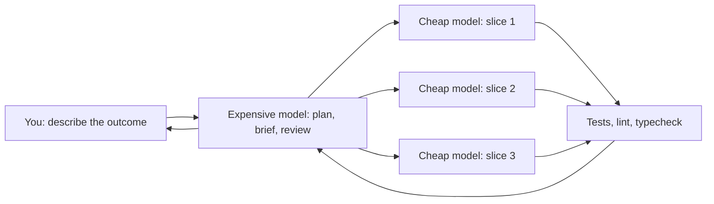
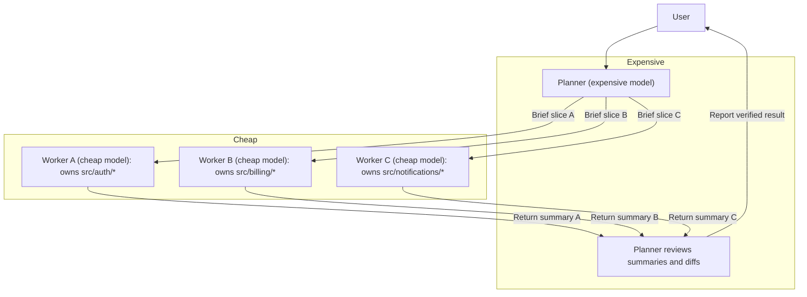
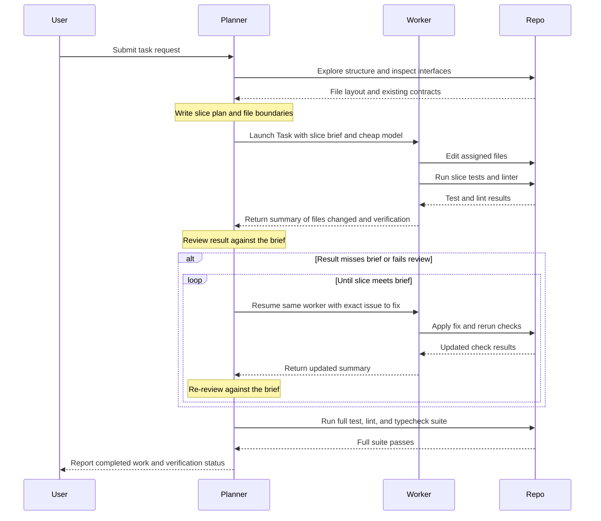
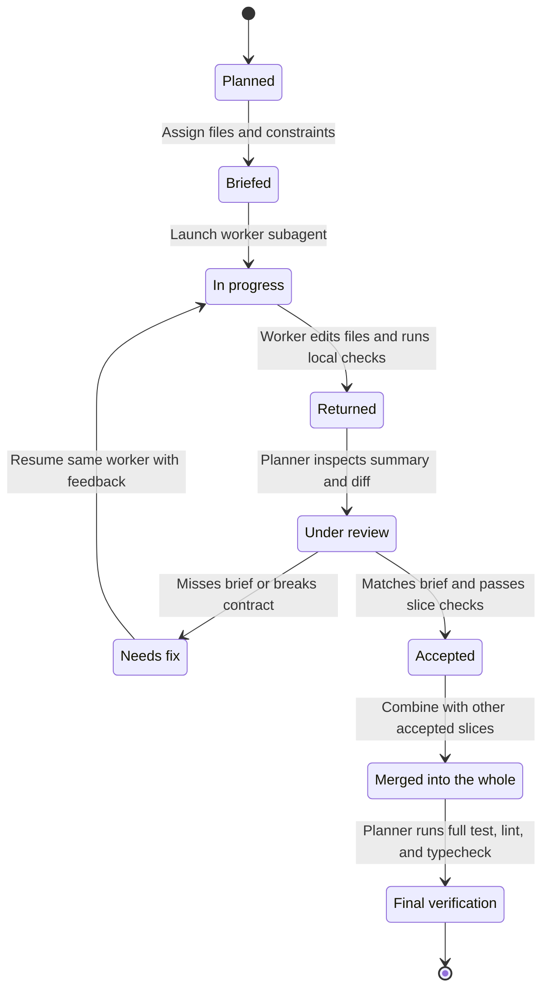
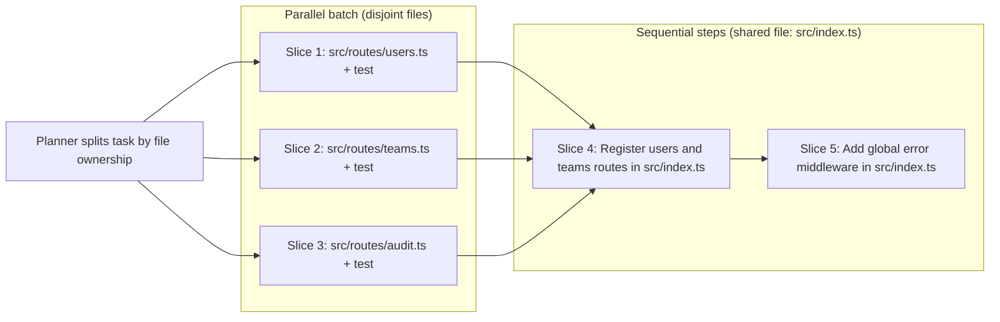
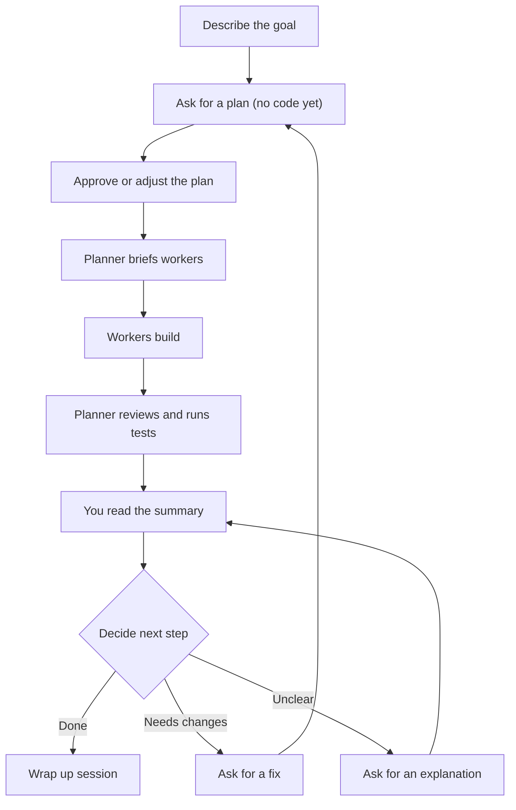
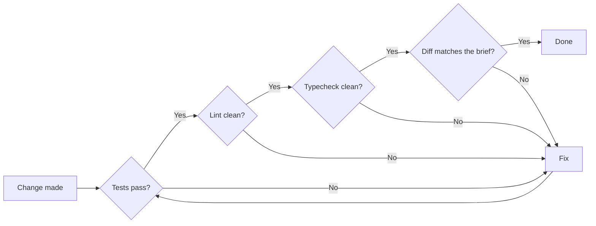
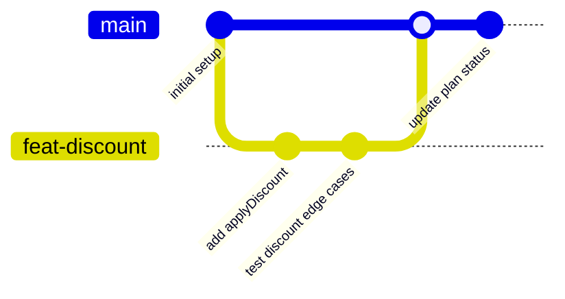

# Expensive planner, cheap workers

The app plan is [README.md](README.md). Deployment is [ARCHITECTURE.md](ARCHITECTURE.md). This file is the workflow guide.

A field guide to getting large coding workloads done with AI by putting one
expensive, capable model in charge of planning and review, and handing the
typing to cheaper, faster models. Written for people who have never worked
this way before, including people who have never written code.

The whole idea in one picture:



## Contents

- [Quick start](#quick-start)
- [Part 1: The pattern — one expensive planner, many cheap workers](#part-1-the-pattern--one-expensive-planner-many-cheap-workers)
- [Part 2: Prompts for someone who has never worked this way](#part-2-prompts-for-someone-who-has-never-worked-this-way)
- [Part 3: A streamlined repo — tests, lint, and hygiene that keep everyone honest](#part-3-a-streamlined-repo--tests-lint-and-hygiene-that-keep-everyone-honest)

## Quick start

1. Open Cursor, select the expensive model in chat, and paste the
   "Start a brand-new project" prompt from Part 2. Approve the plan it gives
   you before it writes anything.
2. Paste "Go build it". The expensive model briefs cheap workers, waits,
   reviews their work, and runs `npm run check` (or your stack's equivalent)
   before reporting back.
3. Read the report with the checklist in "How to tell if it actually did the
   work". If something is off, paste "Review a worker's result".
4. Once the repo exists, paste "Set up the guardrail rules" so the rule files
   in Part 3 (and the delegation rule in Part 1) make this behavior the
   default in every future chat.
5. End every session with the "End of session wrap-up" prompt so the next
   session starts from `docs/plan.md`, not from memory.

If you only remember one thing: the expensive model should think and check;
the cheap models should type. Every "done" is a command that passed, not an
opinion.

## Part 1: The pattern — one expensive planner, many cheap workers

### Why this works

Large coding tasks mix two kinds of work that have very different requirements: high-judgment coordination and high-volume execution. The expensive model is strong at judgment—decomposing a problem into clean boundaries, reviewing diffs against requirements, and catching subtle integration mistakes—but it is poor value when spent typing boilerplate or grinding through mechanical edits across dozens of files. The cheap model is fast and inexpensive at writing code and running local checks, but it drifts when given an open-ended prompt or too much surrounding context.

Pairing one expensive planner in the main chat with many cheap workers launched through Cursor's Task tool puts each model on the work it handles best. By splitting a task into file-disjoint slices, the planner can dispatch multiple workers in parallel without edit collisions. Because each worker runs in its own isolated subagent context and returns only a concise summary, the planner's context window stays small and focused on architecture, verification, and user communication rather than filling up with raw file reads and intermediate compiler output.

| Dimension | Expensive model (Planner / TPM) | Cheap model (Worker subagent) |
| --- | --- | --- |
| Primary strength | Judgment, decomposition, code review, spotting edge cases | Fast code generation, mechanical edits, local test and lint fixes |
| Weak spot | Slow and wasteful when writing routine boilerplate | Drifts without a tight, file-scoped brief |
| Context scope | Whole-task plan, cross-slice interfaces, worker summaries | Single slice brief and only the files assigned to that slice |
| Execution mode | Single coordinator in the main chat | Multiple workers running in parallel on disjoint file sets |
| Output | Slice briefs, review decisions, final verification, user summary | File edits on disk and a compact summary of changes and test runs |

### Roles diagram

The planner owns the conversation with the user and coordinates the workers. Each worker receives an explicit file boundary, performs its edits and checks in isolation, and reports a short summary back to the planner for review.



### The loop

Every task follows a tight feedback loop between the planner and its workers. When a worker misses part of its brief or introduces a regression, the planner does not rewrite the code itself; instead, it resumes the same worker with targeted feedback so the worker already has the relevant files in its context.



### Slice lifecycle

Each slice moves through a predictable set of states from initial planning to final whole-repo verification.



### Parallel vs sequential slicing

Slice by file ownership, not by feature layer. Slices that touch completely disjoint sets of files go out together in a single message so workers run in parallel; slices that must touch a shared file go one after another so workers never overwrite each other's changes.



### What stays with the planner vs what goes to a worker

The planner should not spawn a subagent for trivial actions where writing the brief takes more tokens than doing the work, and it should never hand off overall task judgment.

| Stays with the planner | Goes to a worker |
| --- | --- |
| Answering user questions directly | Multi-file feature implementations and fixes |
| Single symbol or file lookups | Writing or updating unit and integration tests for a slice |
| One-step edits in a single spot | Mechanical refactors across a module |
| Exploring the repo to design the slice plan | Filling in repetitive boilerplate, schemas, or adapters |
| Writing worker briefs and assigning file ownership | Running slice-level tests and fixing lint errors in assigned files |
| Reviewing worker summaries and diffs against the brief | Iterating on compiler or test failures inside a slice |
| Running final repo-wide tests, lint, and typecheck | Updating module-scoped documentation when part of a slice |
| Communicating status, tradeoffs, and results to the user | Applying targeted review fixes when resumed by the planner |

### Anatomy of a good worker brief

A worker subagent starts with a blank slate and cannot see the main chat history. Every brief must be self-contained and include:

- **The goal in one sentence**: state the concrete outcome the slice must achieve.
- **The exact files it may touch**: list every file the worker is allowed to create or modify, and state explicitly that it must not touch any other file.
- **Constraints**: specify coding conventions, existing helpers or libraries to import rather than reimplement, and workspace rules (for example, do not run any git commands).
- **How to verify**: give the exact test, linter, and typecheck commands the worker must run before finishing.
- **What to return**: require a short report listing the files changed, the verification commands run and their results, and anything left undone or blocked.

When launching workers with the Task tool, follow four operational rules:

- **Pass the cheap model explicitly**: always set the `model` parameter to the cheap model rather than omitting it or passing `inherit`, which would run the expensive model for the worker.
- **Launch independent slices in one message**: emit all file-disjoint Task calls in a single assistant turn so Cursor runs them in parallel.
- **Do not run workers in the background**: leave `run_in_background` unset (or `false`) so the planner waits for the batch to finish and reviews the results before moving on.
- **Resume the same worker on a miss**: if a worker leaves a bug, skips a check, or misses part of the brief, resume that same subagent instance with the specific correction instead of redoing the slice in the planner.

Copy and adapt this plain-text brief template when dispatching a worker:

```text
Goal:
Add request validation and unit tests for the POST /v1/webhooks endpoint.

Files to touch (touch ONLY these files; do not modify any other file):
- src/routes/webhooks.ts
- src/routes/webhooks.test.ts

Constraints:
- Use the existing validateBody helper from src/middleware/validate.ts.
- Follow the error response shape in src/errors.ts.
- Do not install new packages.
- Do not run any git commands.

How to verify:
- Run: npm test -- src/routes/webhooks.test.ts
- Run: npm run lint
- Run: npm run typecheck

What to return:
1. Exact list of files changed.
2. The commands you ran to verify and whether each passed.
3. Anything left undone or any contract mismatch you encountered.
```

### A real example of this pattern encoded as a Cursor rule

Instead of pasting coordination instructions into every prompt, you can make the planner follow this workflow automatically by saving a rule file at `.cursor/rules/delegate-to-workers.mdc`.

Cursor rule files support an optional YAML frontmatter block at the top of the file. When present, setting `alwaysApply: true` attaches the rule to every chat session in the repository:

```yaml
---
alwaysApply: true
---
```

Below is the complete `delegate-to-workers.mdc` rule:

````markdown
# Parent is the TPM

On a real task — a feature, a multi-file fix, or any multi-step change —
you plan, assign, wait, and review. You do not implement it.

Split the work into slices. Launch each slice with the Task tool
(`subagent_type` `generalPurpose`, local). Independent slices go out
together in one message. Slices that share files go one after another.

Do not set `run_in_background`. Wait for the workers, then review.

The worker cannot see this conversation. Each prompt carries the goal,
the files to touch, the constraints, and what to return.

Pass `model`. Never omit it and never pass `inherit` — both run your
model. Use `composer-2.5-fast`. If that slug is absent from the
available model list, use the fastest inexpensive slug that is listed.
Do not invent a slug.

## Do it yourself

A question, a lookup, or a one-step edit stays with you. So does the
work when you are already the cheap model. Do not pass the whole
request to one worker and relay the answer.

## Review

Check the result against the brief. If it misses, resume that same
worker with what is wrong. Do not redo the slice yourself.
````

### Common failure modes

When a planner-worker session goes wrong, the cause almost always traces back to a missing boundary in the brief or a skipped review step.

| Symptom | Cause | Fix |
| --- | --- | --- |
| Worker rewrote unrelated files | Brief described the feature goal but did not list the exact files the worker was allowed to touch | List the exact file paths in the brief and state that no other files may be modified |
| Two workers conflicted or overwrote edits | Parallel slices shared a file (for example, a shared barrel export or router index) | Slice by file ownership; run disjoint slices in parallel and chain shared-file edits sequentially |
| Planner redid the work itself after a bad slice | Planner fixed the code directly in the main chat instead of delegating the correction | Resume the same worker with a short description of what missed the brief so it fixes its own slice |
| Planner context blew up mid-task | Planner read full worker transcripts or re-read every touched file in full | Rely on the worker's returned summary and targeted diff or test checks; keep heavy file reading inside workers |
| Worker said "tests pass" but did not run them | Brief asked to "make sure tests pass" without demanding command execution details | Require the worker to return the exact verification commands run and their output, and have the planner run final verification |

## Part 2: Prompts for someone who has never worked this way

### How to read this part

Every prompt below is meant to be copied and pasted directly into your Cursor chat with the expensive model selected. Before sending a prompt, replace anything inside `<angle brackets>` with the specifics of your project or problem. You never have to write or edit code yourself. Your job is to describe the outcome you want, state what the models are allowed to touch, and check the reported result before moving on.

### Your first session

Every session follows the same loop: you set the goal, the expensive model plans and coordinates, the cheap models write the code, and you verify the outcome before deciding what happens next.



### Start a brand-new project

Use this prompt when you are starting in an empty folder and want the expensive model to design the project structure and verification setup before any code is written.

```text
We are starting a brand-new project.

Goal: <describe what you want the program or app to do and who will use it>
Language or stack: <state the language if you know it, or write: pick the simplest mainstream option and tell me why>

Do not write any code or create any files yet. First, give me a clear plan:
1. Recommend the simplest mainstream language and tools for this goal and explain why in plain English.
2. Show the initial folder and file list you plan to create.
3. Define the exact test, lint, and typecheck commands we will run from day one so every change can be verified automatically.
4. Break the initial build into small slices that you can assign to workers using the cheap model.
5. Tell me which slices can run in parallel and which files each slice owns.

Stop after showing the plan and wait for my approval before building anything.
```

### Plan before building

Use this prompt when you already have an existing codebase and want to add a feature or make a multi-step change without the model jumping straight into edits.

```text
I want to make a change to this repository.

Goal: <describe the feature or behavior you want to add or change>
Constraints: <list anything that must not change, or write: keep changes as small as possible>

Plan first, no code yet. Read the repository and give me a breakdown:
1. List the slices of work required to reach the goal.
2. State which slices are independent and can run in parallel, and which slices must go one after another because they share files.
3. List the exact files each slice is allowed to create or modify.
4. State which test, lint, and typecheck commands will verify the work when it finishes.

Do not edit any files and do not launch any workers yet. Stop and wait for my approval.
```

### Go build it

Use this prompt after you have reviewed and approved the plan and are ready for the expensive model to delegate the implementation to cheap workers.

```text
The plan is approved. Go build it as the planner.

Follow this exact process:
1. Do not write the implementation yourself. Split the work according to the approved slices and launch each slice using a worker running the cheap model.
2. Launch independent slices in parallel in a single step, and run slices that share files one after another. Do not run workers in the background; wait for each batch to finish.
3. Give each worker a complete brief: the goal, the exact files it is allowed to touch, the constraints, and the verification commands it should check.
4. When each worker finishes, review its changes against its brief. If anything is missing or touches the wrong files, resume that same worker with clear feedback instead of redoing the work yourself.
5. Once all slices are complete, run the full test, lint, and typecheck commands for the repository and fix any issues until all three pass clean.

When you are done, report back with:
- The exact list of files changed across all slices.
- The exact test, lint, and typecheck commands you ran and their output.
- Anything that was left undone or needs my attention.
```

### Review a worker's result

Use this prompt when the planner reports back on delegated work and you want to verify that each worker stayed within its boundaries and met every requirement.

```text
Before we move on, show me a review of what the workers actually changed compared to what you asked them to do.

For each slice:
1. Summarize the diff against the original brief you gave that worker.
2. Confirm whether the worker touched only the files it was assigned.
3. Point out any requirement from the brief that was skipped, partially done, or changed in an unexpected way.

If anything misses the brief or fails a check, do not patch it yourself. Resume the same worker that owned that slice, tell it specifically what is wrong, wait for it to fix the issue, and re-run the test, lint, and typecheck commands. Report the updated results when clean.
```

### I don't understand this

Use this prompt whenever the model mentions a file, concept, or code change that looks unfamiliar and you want a clear explanation before approving or continuing.

```text
I do not understand <name of the file, change, or concept>.

Do not change any code right now. Explain it to me in plain language:
1. Describe what this part does without programming jargon, as if explaining it to a smart colleague who does not write code.
2. Give me a simple everyday analogy for how it works and how it fits into the rest of the project.
3. Tell me specifically what would break or stop working for the user if this file or change were removed.
4. Tell me if there is any decision you need from me about it right now.
```

### Something is broken

Use this prompt when you hit an error message or unexpected behavior and want the smallest verified fix rather than a guesswork rewrite.

```text
Something is broken.

What I did: <describe the command you ran or the action you took in the app>
What I expected: <describe what should have happened>
What actually happened (error or behavior):
<paste the error message or describe what went wrong>

Follow this sequence:
1. Investigate the codebase and tell me the root cause in one plain-English sentence before making any fix.
2. Propose the smallest change that fixes the root cause without refactoring unrelated code.
3. Delegate the fix to a worker using the cheap model: have it write or update a test that reproduces the failure first, apply the minimal fix, and confirm the failing test turns green.
4. Run the full test, lint, and typecheck suite.
5. Show me the one-sentence root cause, the exact files changed, and the command output proving the test went from failing to passing.
```

### Add tests to something that has none

Use this prompt when a part of your project works manually but has no automated tests to protect it from future mistakes.

```text
The code in <file path or feature area> currently has no automated tests, and I want it covered before we make future changes.

Follow these steps:
1. Read <file path or feature area> and list the specific behaviors and edge cases that are worth testing in plain English.
2. Do not write any test files yet. Stop and let me approve the list of behaviors first.
3. Once I approve, brief a worker using the cheap model to write the tests covering those behaviors.
4. Constraint: the worker may only create or edit test files. It must not change any production code. If it discovers a bug in production code while writing tests, have it stop and report the bug rather than fixing it silently.
5. Run the test, lint, and typecheck commands and show me the exact command output proving the new tests run and pass.
```

### Clean up without changing behavior

Use this prompt when the project works as intended, but you want to tidy up formatting, linter warnings, or unused code safely.

```text
I want to clean up <file paths or area of the repo> without changing how the program behaves.

Scope of cleanup: <for example: fix lint warnings, consistent formatting, remove dead or unused code>

Follow this strict safety procedure:
1. First, run the existing test, lint, and typecheck commands right now and show me that the tests are green before touching anything. If tests are not green right now, stop and tell me.
2. Plan the cleanup slices and brief workers using the cheap model to make the changes.
3. Hard rule: no behavior change. Workers must not alter inputs, outputs, user-facing messages, or business logic.
4. When the workers finish, review their diffs to verify no logic was altered, then run the full test, lint, and typecheck commands again.
5. Show me the before-and-after command results and the exact list of files touched.
```

### Status report: where are we

Use this prompt when a session has been running for a while and you want a quick, scannable snapshot of progress without scrolling through long chat messages.

```text
Give me a status report on where we are right now in under 10 lines total.

Include only these four items:
- Done: what has been built and verified with passing tests, lint, and typecheck.
- In progress: what slice is currently being worked on or reviewed.
- Blocked: anything that failed verification or cannot move forward.
- Needs from me: any question, approval, or decision you need from me to continue.
```

### End of session wrap-up

Use this prompt when you are ready to stop working for the day and want a durable record saved in the repository so you can pick up smoothly next time.

```text
We are wrapping up for today. Do not start any new features.

Please do the following:
1. Run the project's test, lint, and typecheck commands one final time and report the exact commands and their results.
2. List every file that was created, modified, or deleted during this session.
3. Have a worker using the cheap model update `docs/plan.md` (not just this chat): mark each slice's status, then add a short "how to resume" note for future me at the bottom. The note should explain in plain English: what we finished today, what is verified working, what is left to do next, and the exact prompt or command I should run tomorrow to pick right back up.
4. Review `docs/plan.md` and show me a brief summary once it is written.
```

### Set up the guardrail rules

Use this prompt once in any repository so the expensive model automatically follows the planner-and-worker workflow, runs verification checks, and keeps edits minimal in every future chat.

```text
I want to set up permanent Cursor workspace rules in `.cursor/rules/` so that you follow our workflow automatically in every session.

The rules we use are defined in Part 3 of INSTRUCTIONS.md. Please:
1. Plan the `.cursor/rules/` files needed so that:
   - You act as the planner and always delegate multi-file or feature work to workers using the cheap model rather than implementing everything yourself.
   - You always run the repository's test, lint, and typecheck commands and fix any issues before marking work done.
   - Every change uses the principle of least change and touches only the files required.
2. Tell me the exact `.cursor/rules/*.mdc` files you plan to create or update and summarize what each rule enforces.
3. Once I approve, have a worker using the cheap model write those rule files, then review the result and show me the file paths created.
```

### Phrases that work and phrases that backfire

The wording you use in chat shapes how carefully the planner coordinates the work. Small shifts in phrasing prevent runaway edits.

| Phrases that work | Phrases that backfire |
| :--- | :--- |
| "Plan first, no code yet." | "Just make it work." |
| "Smallest change that fixes it." | "Fix everything you see." |
| "Show me the command you ran and its output." | "Use whatever you think is best" (without asking for a plan first). |
| "Only touch these files: `<list>`." | "Don't bother with tests for now." |
| "Stop and ask if you are unsure which of two readings I meant." | Pasting a 400-line error log with no question or context. |
| "Resume the same worker and tell it what missed the brief." | "That's wrong, redo it yourself." |

### How to tell if it actually did the work

Before you accept the planner's final message as done, run through this checklist:

- It named the exact file paths that were created or modified, rather than saying "updated the relevant files."
- It pasted or quoted the exact test, lint, and typecheck commands it ran along with their passing results.
- The summary of changes matches what you asked for in the approved plan, with no surprise extra features or unrequested cleanup.
- It explicitly stated what it did NOT do, or confirmed that nothing from the plan was left undone.
- When you ask "Did you run the tests?", the answer is the command and its output, never "They should pass" or "The logic looks fine."

### Vocabulary

You will see these terms in plans and status reports. Here is what each one means in plain English.

| Term | Plain-English meaning |
| :--- | :--- |
| **Planner** | The expensive, capable model you talk to in chat; its job is to design the plan, assign work, and check results. |
| **Worker** | A fast, cheap model launched by the planner via the Task tool to carry out one focused piece of coding work. |
| **Slice** | One small, self-contained piece of a larger task that can be assigned to a single worker with clear file boundaries. |
| **Brief** | The instructions the planner gives a worker, stating the goal, which files to touch, constraints, and how to verify. |
| **Resume** | Sending feedback back to the exact same worker that did a slice so it can fix a mistake with all its prior context intact. |
| **Lint** | An automated check that scans code for style mistakes, formatting problems, and common suspicious patterns. |
| **Typecheck** | An automated check that verifies different parts of the code agree on the kinds of data (numbers, text, lists) they pass around. |
| **Test** | A small automated script that runs your code with sample inputs and checks that the output matches what is expected. |
| **CI** | Continuous Integration: an automated server that runs your test, lint, and typecheck commands every time code is shared. |
| **PR / pull request** | A proposed bundle of code changes submitted for review before it is merged into the main project. |
| **Diff** | A line-by-line view showing exactly what text was added, removed, or changed in a set of files. |

## Part 3: A streamlined repo — tests, lint, and hygiene that keep everyone honest

### Why hygiene matters more with AI

When you delegate implementation slices to the cheap model, it will naturally drift toward shortcuts, unrequested edits, and plausible-looking code that does not quite compile. The only cheap, reliable check against that drift is an automated command that returns an unambiguous pass or fail exit code. In a multi-agent workflow, "done" must be defined by deterministic commands running in the terminal, never by a model's confident opinion that its changes look fine. Keeping the work broken into small slices and small pull requests makes it possible for both the planner model and the human to review every line without fatigue. Finally, storing repository rule files in version control makes this good behavior the automatic default for every session, rather than instructions you have to remember to type into every prompt.

### Definition of done

Every slice assigned to a worker follows the same verification loop before the planner accepts it.



A slice is only complete when it satisfies all five checks in order:

- The automated test suite runs and passes with zero failures, including tests covering the new or changed behavior.
- The linter exits with zero errors and zero new warnings across the repository.
- The static typechecker verifies the entire project without emitting errors or falling back to unsafe casts.
- The file diff touches only the files and scope specified in the planner's brief, with no stray edits or formatting churn.
- Any relevant documentation in `docs/` has been updated to match the new behavior.

### Minimal repo layout

The example stack below is a small TypeScript and Node project, though the exact same shape applies to any language and toolchain.

```text
.
├── .cursor/
│   └── rules/
│       ├── git-status-only.mdc
│       ├── least-change.mdc
│       ├── test-and-lint.mdc
│       └── this-checkout-only.mdc
├── .github/
│   └── workflows/
│       └── ci.yml
├── docs/
│   ├── decisions.md
│   └── plan.md
├── src/
│   └── price.ts
├── tests/
│   └── price.test.ts
├── .editorconfig
├── .gitignore
├── .nvmrc
├── eslint.config.js
├── package.json
├── README.md
└── tsconfig.json
```

Each entry in the layout has a single job:

- `README.md` — explains what the project does, how to install dependencies, and how to run the verification commands.
- `package.json` — declares dependencies and defines the zero-argument scripts for testing, linting, and typechecking.
- `tsconfig.json` — configures strict TypeScript compiler checks across both source and test files.
- `eslint.config.js` — configures static code analysis rules using the flat ESLint format.
- `.editorconfig` — enforces consistent line endings, character encoding, and indentation across editors and AI tools.
- `.gitignore` — prevents build artifacts, installed dependencies, logs, and local secret files from entering version control.
- `.nvmrc` — pins the exact Node runtime version used by local shells and continuous integration.
- `src/` — holds the production source code organized into small, focused modules.
- `tests/` — holds the automated test files (alternatively co-located as `src/**/*.test.ts`).
- `docs/` — stores living architecture decisions, the current slice plan, and durable project notes as plain markdown.
- `.cursor/rules/` — contains `.mdc` rule files that instruct the expensive model and the cheap model how to behave in this repository.
- `.github/workflows/ci.yml` — runs the exact same verification command on every push and pull request.

### The three commands

Every repository needs three core verification commands that run the full check with no extra arguments: `npm test`, `npm run lint`, and `npm run typecheck`. Workers should never have to guess flags, file paths, or runner options. Defining a combined `check` script lets humans, workers, and continuous integration run all three gates with one command.

```json
{
  "name": "example-service",
  "version": "0.1.0",
  "private": true,
  "type": "module",
  "scripts": {
    "test": "vitest run",
    "lint": "eslint .",
    "typecheck": "tsc --noEmit",
    "check": "npm test && npm run lint && npm run typecheck"
  },
  "devDependencies": {
    "@eslint/js": "^9.15.0",
    "eslint": "^9.15.0",
    "typescript": "^5.7.0",
    "typescript-eslint": "^8.15.0",
    "vitest": "^2.1.0"
  }
}
```

If your project uses Python, Go, Rust, or another stack outside Node, expose the exact same four entry points through a `Makefile`:

```makefile
.PHONY: test lint typecheck check

test:
	pytest -q

lint:
	ruff check .

typecheck:
	mypy src tests

check: test lint typecheck
```

### Minimal config files

Set up these five configuration files on day one before asking workers to write feature code. Keeping them minimal prevents configuration drift while catching mistakes immediately.

#### `.editorconfig`

```ini
root = true

[*]
charset = utf-8
end_of_line = lf
insert_final_newline = true
trim_trailing_whitespace = true
indent_style = space
indent_size = 2

[Makefile]
indent_style = tab
```

#### `.gitignore`

```gitignore
node_modules/
dist/
coverage/
.env
.DS_Store
*.log
```

#### `eslint.config.js`

```js
import js from "@eslint/js";
import tseslint from "typescript-eslint";

export default tseslint.config(
  { ignores: ["dist/**", "node_modules/**", "coverage/**"] },
  js.configs.recommended,
  ...tseslint.configs.recommended,
);
```

#### `tsconfig.json`

```json
{
  "compilerOptions": {
    "target": "ES2022",
    "module": "NodeNext",
    "moduleResolution": "NodeNext",
    "strict": true,
    "noEmit": true,
    "skipLibCheck": true
  },
  "include": ["src", "tests"]
}
```

#### `.github/workflows/ci.yml`

```yaml
name: ci

on:
  push:
    branches: [main]
  pull_request:

jobs:
  check:
    runs-on: ubuntu-latest
    steps:
      - uses: actions/checkout@v4
      - uses: actions/setup-node@v4
        with:
          node-version-file: ".nvmrc"
          cache: "npm"
      - run: npm ci
      - run: npm run check
```

### Tests: what to ask for

When the planner assigns a test slice to a worker, the brief should specify exact inputs, outputs, and edge cases. Good unit tests exercise pure functions and public interfaces without coupling to private internals.

```ts
// src/price.ts
export function applyDiscount(cents: number, percentOff: number): number {
  if (!Number.isInteger(cents) || cents < 0) {
    throw new RangeError("cents must be a non-negative integer");
  }
  if (percentOff < 0 || percentOff > 100) {
    throw new RangeError("percentOff must be between 0 and 100");
  }
  return Math.round(cents * (1 - percentOff / 100));
}

// tests/price.test.ts
import { describe, expect, it } from "vitest";
import { applyDiscount } from "../src/price.js";

describe("applyDiscount", () => {
  it("reduces the price by the given percentage rounded to nearest cent", () => {
    expect(applyDiscount(1000, 15)).toBe(850);
    expect(applyDiscount(999, 10)).toBe(899);
  });

  it("returns zero when discount is 100 percent", () => {
    expect(applyDiscount(500, 100)).toBe(0);
  });

  it("rejects negative prices or out-of-range percentages", () => {
    expect(() => applyDiscount(-1, 10)).toThrow(RangeError);
    expect(() => applyDiscount(500, 120)).toThrow(RangeError);
  });
});
```

Follow five rules when directing workers to write or update tests:

- Test observable behavior and return values, not internal implementation details or private helper calls.
- Keep one assertion topic per test so a failure immediately tells you which requirement broke.
- Write test names that state what is true in plain English rather than repeating the function name.
- Never let a worker change production code and existing tests in the same slice unless the brief explicitly calls for both; otherwise a worker may weaken a test to make its broken code pass.
- Start every bug fix by writing a failing test that reproduces the bug before touching production code.

### Change lifecycle

Every slice moves through a short-lived branch with small, focused commits before merging back to `main`.



Keep the lifecycle predictable with five habits:

- Create one short-lived branch per planned slice rather than piling unrelated features onto a long-running branch.
- Keep one logical concern per commit so any broken step can be inspected or reverted cleanly.
- Write commit messages that state what changed and why, avoiding vague labels like "fix stuff" or "updates".
- Size pull requests so a human reviewer can read and understand the entire diff in five minutes or less.
- Never merge a branch while tests, linting, or typechecks are red.

### Repository hygiene rules

Day-to-day repository discipline keeps both human contributors and AI workers from tripping over stale artifacts:

- Keep `main` green at all times; if `main` breaks, fixing it preempts every other slice.
- Commit no generated files, build outputs, or coverage reports (`dist/` and `coverage/` stay in `.gitignore`).
- Commit no secrets or API keys; ignore `.env` and commit a `.env.example` file with dummy placeholders instead.
- Pin exact dependency versions via a committed lockfile (`package-lock.json`) and install with `npm ci` in automation.
- Keep durable documentation in `docs/` as plain markdown and update it in the same change as the code it describes.
- Delete dead or superseded code outright instead of leaving commented-out blocks behind.
- Maintain a single source of truth for commands (`package.json` scripts or a `Makefile`, never both diverging).

### Encode the hygiene as Cursor rules

Prose guidelines in a `README.md` only help if someone reads them; files under `.cursor/rules/*.mdc` turn those guidelines into active constraints. Each `.mdc` file is plain markdown with an optional YAML frontmatter block where setting `alwaysApply: true` loads the rule into every chat session automatically. Committing `.cursor/rules/` directly into the repository ensures that every human collaborator, the planner, and every spawned worker operates under the exact same ground rules.

#### `.cursor/rules/test-and-lint.mdc`

````markdown
# Test, lint, and typecheck before done

Before you mark a change done, run the project's tests, linter, and typecheck, and fix what they report.

Use the commands the repo already defines (`package.json` scripts, a `Makefile`, or the docs). Do not invent a new runner.

- Run the tests that cover the change. If the suite is small, run it all.
- Run the project's lint script, or the linter on the files you touched.
- Run the project's typecheck script when it has one (`npm run typecheck` here).
- A change is done only after tests, lint, and typecheck finish clean. If you stop short, report the exact failure and why.
- Do not claim tests, lint, or typecheck passed unless you ran them in this session.

```text
# ❌ BAD — edit, then say it's done
"Updated the route. Tests look fine."

# ✅ GOOD — run, then report
npm test
npm run lint
npm run typecheck
"Tests, lint, and typecheck passed."
```

If the repo has no test, lint, or typecheck command, say so. Do not skip the check in silence.
````

#### `.cursor/rules/git-status-only.mdc`

````markdown
# Git status only

The only allowed git command is `git status`.

Never run any other git command, including `log`, `diff`, `show`, `blame`,
`add`, `commit`, `push`, `pull`, `fetch`, `checkout`, `switch`, `merge`,
`rebase`, `stash`, `reset`, `clone`, or `init`. Do not inspect git history.

Never create, switch, or delete branches.

Never open, create, update, or push pull requests (`gh pr`, GitHub UI, or
otherwise).

Never initialize a repository (`git init` or equivalent).

If git work beyond status seems needed, stop and ask the user to do it.
````

#### `.cursor/rules/this-checkout-only.mdc`

````markdown
# This checkout only

The bound is the workspace git root. Own that repo. Leave the others
alone.

Do not read, write, search, or `git status` a sibling checkout
(anything under `repos/` that is not this workspace). Do not `cd` there.
Do not "coordinate" by patching the other side of a wire.

If the change belongs in another repo, say so and stop. The agent
that owns that checkout does the work.

```text
# ❌ BAD — one session writing into a sibling repo
edit ../other-repo/src/Wire.kt

# ✅ GOOD — stay put; name the other checkout if needed
This change belongs to other-repo. Stop. Do not open it.
```
````

#### `.cursor/rules/least-change.mdc`

````markdown
# Least change

Use the principle of least change. Do not change more than the task needs.

- Never assume something is fixed because you edited it. Run the check.
- Prefer importing a maintained library over writing it yourself. The best code is no code.
- Fix every lint error you introduce or touch.
- Follow the repo's existing style guide. Do not introduce a second style.
````

The `git-status-only` rule is designed for developers who want to stay in full control of commits, branches, and history themselves: the AI edits and verifies the working tree, and the human reviews the diff and commits. Teams that trust the AI to create branches and commits can omit `git-status-only`, while the other three rules (`test-and-lint`, `this-checkout-only`, and `least-change`) serve as strong defaults for almost every repository. Pair them with the `delegate-to-workers` rule shown in Part 1 of INSTRUCTIONS.md so the expensive model plans and reviews while the cheap model executes each slice.

### Keeping a long project on track

Multi-session projects stay coherent when state lives in the repository rather than inside a long, decaying chat transcript:

- Maintain `docs/plan.md` with the ordered list of slices and their current status, updated by the planner at the end of each session.
- Maintain `docs/decisions.md` with dated, one-paragraph records explaining key architectural choices and trade-offs.
- Have the planner write a brief "how to resume" note at the bottom of `docs/plan.md` before closing a session so the next session starts with immediate context.
- Run `npm run check` at the very start of every session before planning or editing anything to confirm the baseline is still green.
- Whenever a model breaks the same expectation twice, turn that correction into a `.cursor/rules/*.mdc` file immediately instead of repeating it in chat.
