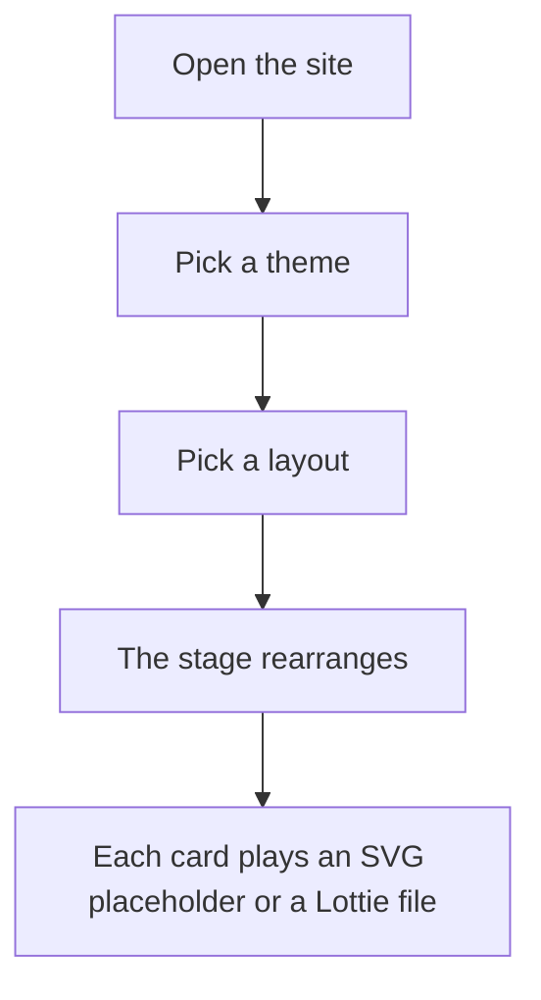

# thu

This site is a mobile-first gallery of animations. It is meant to be opened from Instagram on a phone, with layouts that still read clearly on a desktop. How it is built and deployed is documented in [ARCHITECTURE.md](ARCHITECTURE.md). The AI workflow for changes lives in [INSTRUCTIONS.md](INSTRUCTIONS.md).

If you are new to coding, read [docs/concepts.md](docs/concepts.md) before the rest of this file. It explains the folders, commands, and vocabulary used in this project in plain language.

## Themes

Four palettes are available from the Theme dropdown. The choice sets `data-theme` on the document and is remembered in `localStorage` under `thu-theme`.

- **Neon** (default): magenta and lime accents on a dark base.
- **Mango**: orange and gold on deep plum.
- **Lagoon**: cyan and yellow on deep teal.
- **Candy**: hot pink and violet on pink paper.

## Layouts

The Layout dropdown sets `data-layout` on the stage and is remembered in `localStorage` under `thu-layout`.

- **Stack** (default): full-height vertical snap—the primary phone layout.
- **Grid**: one column on narrow screens, then two, three, and four columns as the viewport widens.
- **Feature**: the first card is large; the rest are smaller tiles.
- **Reel**: horizontal snap through the cards.

## One visit



## Replacing animations

The only catalog list is `src/catalog.ts`. Animation files live in `public/animations/*.svg` and `public/lottie/*.json`.

To swap a placeholder for a real Lottie animation, put the JSON in `public/lottie/`, then set that entry’s `kind` to `"lottie"` and `src` to `/lottie/<file>.json`. Overwriting a file at the same path needs no code change.

The four SVGs (`orbit`, `pulse`, `bars`, `blob`) and two Lottie files (`pop`, `spin`) are stand-ins, not final artwork.

## Run it

```bash
npm install
npm run dev
```

`.env` is gitignored. If `.env` is missing, copy [.env.example](.env.example). Local dev only needs `VITE_SITE_NAME` from that file. Leave `CLOUDFLARE_ACCOUNT_ID` and `CLOUDFLARE_API_TOKEN` empty until you deploy. Do not paste API tokens into chat.

## Checks

`npm run check` runs test, lint, and typecheck. A change is done only when that command exits 0.

## Deploy

`npm run deploy` loads `.env` and runs Wrangler. GitHub Actions ([`.github/workflows/ci.yml`](.github/workflows/ci.yml)) runs `npm run check` on every push and pull request, and deploys to Cloudflare Workers on a push to `main` using repository secrets `CLOUDFLARE_API_TOKEN` and `CLOUDFLARE_ACCOUNT_ID`.

For local deploy without putting a token in the repo, `npx wrangler login` authenticates Wrangler on your machine but does not fill `.env`. The npm deploy script still reads `.env`, so the token and account id must be present there for `npm run deploy`.

## Phone and desktop

Controls stay in a sticky top bar so the in-app browser can keep the bottom chrome. Selects use 16px type so iOS does not zoom on focus. **Stack** is the layout to open with from a social link.

From 900px width, the bar becomes one row and Grid grows to three then four columns.
