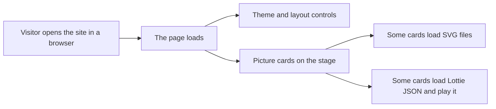

# Concepts in this repo

This page explains the words and folders used in **thu**, a small website that shows moving pictures in a grid you can scroll through on a phone or computer. The project name is also the default site title visitors see in the top bar. You do not need prior coding experience; when a file type appears for the first time, we say what the letters after the dot mean. Read this before [README.md](../README.md) if technical terms there feel unfamiliar.

## The picture

When someone opens the site, their phone or laptop browser loads one page. That page draws a top bar with choices for color scheme (theme) and how cards are arranged (layout). The title in that bar comes from a setting file on the developer machine, not from something the visitor types. Below the bar, each card shows a title and a moving picture. Some pictures come from drawn `.svg` files stored under `public/animations/`; others come from `.json` animation data under `public/lottie/` that a library plays inside the card. Nothing in this flow requires installing an app store app unless the visitor chooses to install the site as a PWA after it loads.



## Where things live

Everything below lives under one folder on disk (this repository). Paths use forward slashes like URLs. A path starting with `src/` is source code; a path starting with `public/` is a file the browser can download directly after build.

Important paths in this project (not every file inside `node_modules/`):

```text
thu/
├── .github/workflows/ci.yml
├── .husky/pre-commit
├── docs/
│   └── concepts.md
├── public/
│   ├── animations/          # orbit.svg, pulse.svg, bars.svg, blob.svg
│   ├── lottie/              # pop.json, spin.json
│   └── favicon.svg
├── src/
│   ├── components/          # AnimationCard, Controls, LottieArtwork, SvgArtwork
│   ├── App.tsx
│   ├── catalog.ts
│   ├── layouts.ts
│   ├── main.tsx
│   ├── storage.ts
│   ├── styles.css
│   └── themes.ts
├── tests/
├── worker/
│   └── index.ts
├── index.html
├── package.json
├── package-lock.json
├── vite.config.ts
├── vitest.config.ts
├── wrangler.jsonc
├── tsconfig.json
├── eslint.config.js
├── .env
├── .env.example
├── .gitignore
├── .nvmrc
├── README.md
├── ARCHITECTURE.md
└── INSTRUCTIONS.md
```

- **`src/`** — The living code for what you see on screen: lists of animations, themes, layouts, and the pieces that draw each card.
- **`public/`** — Files copied to the site as-is (icons and animation files the browser can request by URL).
- **`public/animations/`** — Stand-in `.svg` drawings used by SVG cards.
- **`public/lottie/`** — `.json` files in Lottie format used by animated cards.
- **`worker/`** — A small Cloudflare Worker program; today it answers `/api/health` and can grow for server-side logic.
- **`tests/`** — Automated checks that run in Node to catch regressions in catalog and UI behavior.
- **`docs/`** — Extra documentation for humans; this file lives here.
- **`.github/workflows/`** — GitHub Actions recipes that run checks and deploy on push.
- **`.husky/`** — Git hook scripts; before each commit, the project runs the full check suite locally.
- **`index.html`** — The single HTML shell: it loads the JavaScript entry and provides the `#root` mount point.
- **`package.json`** — Project name, dependency list, and named commands (`npm run dev`, and so on).
- **`package-lock.json`** — Exact versions npm installed so everyone gets the same dependency tree.
- **`vite.config.ts`** — Settings for Vite (dev server, build, PWA plugin, Cloudflare plugin). A `.ts` file is TypeScript source.
- **`wrangler.jsonc`** — Cloudflare Wrangler settings for deploy (Worker entry, static assets, SPA routing).
- **`tsconfig.json`** — TypeScript compiler options (strictness, which folders to type-check).
- **`eslint.config.js`** — ESLint rules for code style and common mistakes in `.js`/`.ts`/`.tsx` files.
- **`.env`** — Local secrets and settings on your machine (not committed). Holds site name and optional Cloudflare keys.
- **`.env.example`** — A safe template showing which variables exist without real secrets.
- **`.gitignore`** — Tells Git which files to leave out of the repository (for example `node_modules/` and `.env`).
- **`.nvmrc`** — Pins the Node.js major version (22) for local dev and CI.
- **`README.md`** — Short product overview: themes, layouts, how to run and deploy.
- **`ARCHITECTURE.md`** — How the app is hosted on Cloudflare Workers, PWA behavior, and routing.
- **`INSTRUCTIONS.md`** — Long-form notes for AI-assisted changes in this repo.
- **`vitest.config.ts`** — Test runner settings (jsdom environment, setup file) used when you run `npm test`.
- **`node_modules/`** — Created by `npm install`; holds downloaded packages. Never edit by hand; it is gitignored.
- **`dist/`** — Created by `npm run build`; optimized files Wrangler uploads. Also gitignored.

The list in `src/themes.ts` and `src/layouts.ts` is separate from the catalog: themes and layouts only change colors and arrangement, not which animation files exist. `src/components/Controls.tsx` renders the two dropdowns and calls back into `App` when the visitor changes a selection.

## Words

| Term | Meaning |
| --- | --- |
| HTML | The markup language in `index.html` that defines the page skeleton (headings, the empty `#root` div, script tags). Browsers turn HTML into the visible page structure. |
| CSS | Styles in `src/styles.css` that control colors, spacing, and layout. CSS can read **CSS variables** set on `html[data-theme="..."]` so themes swap palettes without rewriting every rule. |
| JavaScript | The programming language browsers run. This repo writes almost no plain `.js` by hand; most logic is TypeScript that compiles to JavaScript. |
| TypeScript | JavaScript with type annotations (`.ts` and `.tsx` files). The compiler catches many mistakes before the site runs. `npm run typecheck` runs `tsc --noEmit` over the project. |
| TSX | TypeScript mixed with XML-like UI syntax used by React (for example `src/App.tsx`). Files ending in `.tsx` describe components that return HTML-like tags. |
| JSON | JavaScript Object Notation, a text format for structured data. Lottie animations here are `.json` files under `public/lottie/`. The page reads them with `fetch`, then `.json()` on the response. |
| SVG | Scalable Vector Graphics: XML-based drawings (`.svg`). Four placeholders live in `public/animations/`. The page fetches them and inlines the markup safely (rejecting files that contain `<script`). |
| Lottie | A format for vector animations exported as JSON. The `lottie-web` package reads that JSON and draws frames inside a div. Cards `pop` and `spin` use it. |
| React | A library for building UI from reusable **components**. The app mounts at `#root` via `createRoot` in `src/main.tsx`. |
| component | A named UI piece, usually one file under `src/components/`. Example: `AnimationCard` shows one catalog entry. |
| prop | Short for property: inputs passed into a component, like `entry` on `AnimationCard` or `src` on `LottieArtwork`. |
| state | Data that can change over time inside a component. `App` keeps `theme` and `layout` in `useState`; updating state re-renders the UI. |
| effect | Side work tied to renders, declared with `useEffect`. Examples: fetch animation files, apply `data-theme` on the document, save choices to **localStorage**. |
| hook | A React function whose name starts with `use` (`useState`, `useEffect`, `useRef`). Hooks let function components hold state and run effects. |
| catalog | The single list in `src/catalog.ts` describing every card: id, title, kind (`svg` or `lottie`), and `src` URL path. |
| theme | A color palette (Neon, Mango, Lagoon, Candy). Choosing one sets `data-theme` on `<html>` and is stored under the key `thu-theme`. |
| layout | How cards are arranged (Stack, Grid, Feature, Reel). The stage section gets `data-layout`; the choice is stored as `thu-layout`. |
| CSS variable | A named value in CSS such as `--bg` or `--accent`. Themes define different values; components use `var(--bg)` so one stylesheet supports all palettes. |
| localStorage | A small key-value store in the browser. `src/storage.ts` reads and writes theme and layout so the next visit remembers your picks. |
| DOM | Document Object Model: the live tree of nodes the browser builds from HTML. React updates the DOM when state changes; effects can touch `document.documentElement`. |
| SPA | Single-page application: one HTML shell (`index.html`) and JavaScript swaps content without full page reloads. Cloudflare serves `index.html` for unknown navigation paths. |
| PWA | Progressive Web App: can be installed like an app and work offline in a limited way. Enabled here by `vite-plugin-pwa` (manifest + service worker). |
| service worker | A background script registered by the PWA plugin. It caches built files so repeat visits load faster; dev mode keeps it off (`devOptions.enabled: false`). |
| manifest | `manifest.webmanifest` (generated at build) describes name, icons, colors, and start URL for install prompts. |
| API | Application Programming Interface: URLs the app can call for data. This Worker exposes `/api/health` returning `{ ok: true }` as JSON. |
| Worker (Cloudflare) | Server code at the edge in `worker/index.ts`. Wrangler deploys it with static assets; `/api/*` routes hit the Worker first per `wrangler.jsonc`. |
| static asset | A file served as-is (SVG, Lottie JSON, favicon, built JS/CSS). Vite copies `public/` into the build output for hosting. |
| bundler | A tool that combines many source files into optimized bundles for production. Vite is the bundler here. |
| Vite | Dev server and production build tool configured in `vite.config.ts`. It uses plugins for React, PWA, and Cloudflare. |
| dev server | Local web server from `npm run dev` that rebuilds on save and serves the app at a localhost URL. |
| build | Production compile: `npm run build` type-checks then runs `vite build`, outputting hashed files under `dist/` (gitignored). |
| deploy | Publishing the built site to Cloudflare. `npm run deploy` builds, then runs Wrangler with credentials from `.env`. |
| package | An npm module listed in `package.json` `dependencies` or `devDependencies` (for example `react`, `vite`). |
| dependency | An external package your code imports. Runtime deps include React and `lottie-web`; dev deps include ESLint, Vitest, and Wrangler. |
| lockfile | `package-lock.json` records exact installed versions so `npm ci` in CI matches your machine. |
| npm script | A named command in `package.json` `scripts`, run as `npm run <name>` (or `npm test` for the special `test` script). |
| test | Automated examples that assert behavior. `npm test` runs Vitest on files like `tests/catalog.test.ts` and `tests/App.test.tsx`. |
| linter | ESLint scans source for style and bug patterns. `npm run lint` runs `eslint .`. |
| typecheck | Verifies TypeScript types without emitting files. Part of `npm run build` and `npm run check`. |
| pre-commit hook | Script in `.husky/pre-commit` that runs `npm run check` before Git records a commit, blocking broken commits locally. |
| CI | Continuous integration: GitHub Actions workflow `.github/workflows/ci.yml` runs `npm ci` and `npm run check` on every push and pull request. |
| Git | Version control tracking project history. This folder is a Git **repository**; `.gitignore` excludes local artifacts. |
| repository | The project tree plus its Git history. Collaborators clone the repo to get the same files and scripts. |
| branch | A named line of development (for example `main`). CI deploys to Cloudflare only on push to `main`. |
| environment variable | A named value outside source code, often in `.env`. `VITE_SITE_NAME` becomes `import.meta.env.VITE_SITE_NAME` in the client build. |
| secret | Sensitive values (API tokens) kept out of Git. GitHub stores `CLOUDFLARE_API_TOKEN` and `CLOUDFLARE_ACCOUNT_ID` as repository secrets for deploy. |
| viewport | The visible browser area. `index.html` sets a mobile-friendly viewport meta tag; layouts respond as the viewport widens. |
| mobile-first | Design choices that prioritize phones (sticky top bar, 16px selects to avoid iOS zoom, Stack layout for social links). Desktop layouts add columns from 900px up. |
| StrictMode | A React wrapper in `main.tsx` that double-invokes some lifecycle logic in development to surface unsafe side effects. It is not shown to visitors in production behavior beyond extra dev checks. |
| Node.js | The JavaScript runtime on your computer that runs Vite, Vitest, ESLint, and Wrangler during development. Version 22 is pinned in `.nvmrc`. |
| npm | Node’s package manager. It reads `package.json`, installs **dependencies**, and runs **npm script** commands. |
| fetch | Browser API to request a URL and read the response. `LottieArtwork` and `SvgArtwork` use `fetch(src)` to load files from `public/`. |
| Wrangler | Cloudflare’s command-line tool for deploy and local Workers debugging. The deploy script calls Wrangler after the Vite **build**. |
| ESLint | The **linter** engine configured in `eslint.config.js`. It flags unused variables, risky patterns, and style issues. |
| Vitest | The **test** runner configured in `vitest.config.ts`. Tests simulate a browser with jsdom and render React components in memory. |
| Husky | A small tool wired by the `prepare` npm script that installs Git hooks under `.husky/`. |
| Cloudflare | The hosting company that serves the built site from data centers close to visitors. Workers run **Worker** code; static files come from the asset pipeline. |
| import | How source files pull in other modules, for example `import App from "./App"`. Only values prefixed for Vite (like `VITE_SITE_NAME`) are exposed to client code from **environment variable** files. |
| reduced motion | An accessibility setting some systems expose. `LottieArtwork` reads `prefers-reduced-motion` and stops autoplay when the visitor prefers less movement. |
| aria-label | Accessible name text for screen readers, used on the stage section and artwork containers. |
| module | In modern JavaScript, each file is a module with its own scope. `index.html` loads `main.tsx` as `type="module"`. |
| hot reload | During **dev server** use, Vite pushes updates into the browser without a full refresh when you save a file. |
| edge | Cloudflare’s term for running code close to the user. The **Worker** runs at the edge; static **static asset** files are cached there too. |
| pull request | A GitHub proposal to merge one **branch** into another. CI runs `npm run check` on every pull request before maintainers merge. |
| push | Uploading local Git commits to GitHub. Pushes to `main` trigger deploy after checks pass. |
| commit | A saved snapshot of changes in Git. The **pre-commit hook** runs checks before the snapshot is created. |
| placeholder | Temporary stand-in artwork. README notes the four SVGs and two Lottie files are placeholders, not final art. |
| dropdown | The Theme and Layout `<select>` elements in `Controls`. They list ids from `themes.ts` and `layouts.ts`. |
| stage | The `<section className="stage">` in `App` that holds all cards. Its `data-layout` attribute drives CSS layout modes. |
| tsconfig | Shorthand people use for `tsconfig.json`. It tells the TypeScript compiler which files belong to the app and how strict to be. |
| jsdom | A simulated browser environment Vitest uses so tests can call `document` APIs without opening Chrome. |
| Workbox | Libraries bundled by `vite-plugin-pwa` that generate the **service worker** caching rules during **build**. |

## What happens when you run a command

1. **`npm install`** — Reads `package.json` and `package-lock.json`, downloads listed packages into `node_modules/`, and runs the `prepare` script so Husky installs the pre-commit hook. Nothing is deployed; your machine gets a complete toolchain and libraries. The first install can take a minute because it copies thousands of small files from the npm registry. You repeat install when dependencies change or when cloning the repo on a new computer.

2. **`npm run dev`** — Starts the Vite development server with the Cloudflare plugin so behavior is close to production. The server watches `src/` and reloads when you save. The browser loads `index.html`, which pulls in `src/main.tsx` and hot-updates React components. PWA service worker stays disabled in dev. Vite also serves files from `public/` at the same paths used in production (`/lottie/pop.json`, and so on). Open the URL Vite prints in the terminal (usually a localhost port).

3. **`npm run check`** — Runs three gates in order: Vitest tests (`npm test`), ESLint (`npm run lint`), then TypeScript (`npm run typecheck`). If any step fails, the command stops with a non-zero exit code. This is what CI and the pre-commit hook use. Tests render `App` with Testing Library, assert catalog shape, and avoid needing a real browser window. Lint and typecheck scan both `src/` and `worker/` even though visitors only see the React half.

4. **`npm run deploy`** — First runs `npm run build` (typecheck plus Vite production build, PWA manifest and service worker included). Then Node loads `.env` and invokes Wrangler to upload the Worker and static assets to Cloudflare. You need `CLOUDFLARE_ACCOUNT_ID` and `CLOUDFLARE_API_TOKEN` filled in `.env` for this to succeed. GitHub Actions on `main` runs the same build and deploy steps using repository **secret** values instead of your local `.env`. A failed deploy leaves the previous live version unchanged on Cloudflare.

Related commands not listed above but present in `package.json`:

- **`npm run build`** — Typecheck and production bundle only; writes to `dist/` without uploading.
- **`npm run preview`** — Serves the production build locally inside the Workers runtime for a final smoke test.
- **`npm test`**, **`npm run lint`**, and **`npm run typecheck`** — Individual pieces of **`npm run check`** if you want to run one gate at a time while fixing errors.

## How a card gets on screen

**Lottie example (`pop`):**

1. `src/catalog.ts` lists an entry with `id: "pop"`, `kind: "lottie"`, and `src: "/lottie/pop.json"`. The file on disk is `public/lottie/pop.json`; the leading slash in `src` means “from the site root,” not from inside `src/`.
2. `src/main.tsx` mounts `App` into the `#root` element from `index.html`. `src/App.tsx` imports `animations` from the catalog and maps each entry to `src/components/AnimationCard.tsx`, passing the entry as a **prop**. It also renders `Controls` above the stage so theme and layout can change without reloading the page.
3. `AnimationCard` reads `entry.kind`. When it equals `"lottie"`, the card renders `src/components/LottieArtwork.tsx` with `src="/lottie/pop.json"` and `title="Pop"`.
4. `LottieArtwork` keeps a ref to an empty div, then runs a **effect** that `fetch`es `/lottie/pop.json`. On success it parses the body as **JSON** and passes that object to `lottie.loadAnimation` from `lottie-web`, which draws SVG frames inside the div. On failure it sets **state** `failed` and shows a text fallback. Cleanup destroys the animation if the card unmounts or `src` changes.

The `spin` card follows the same path with `public/lottie/spin.json` and catalog `src: "/lottie/spin.json"`.

**SVG example (`orbit`):**

The catalog points `orbit` at `/animations/orbit.svg` with `kind: "svg"`. `AnimationCard` renders `src/components/SvgArtwork.tsx`, which **fetch**es the file, rejects markup that contains `<script`, and stores the SVG string in **state**. The component injects that markup into the **DOM** when safe. CSS in `src/styles.css` styles `.artwork--svg` and `.card` the same way for all four SVG placeholders (`orbit`, `pulse`, `bars`, `blob`).

To add a new moving picture later, put the file under `public/animations/` or `public/lottie/`, add a matching row in `src/catalog.ts`, and rebuild or refresh dev. The UI picks it up automatically because `App` always maps the whole `animations` array.

Changing only `src/styles.css` updates colors, spacing, or motion without touching the catalog. Changing `src/themes.ts` or `src/layouts.ts` adds or renames choices in the dropdowns; you must also add matching CSS selectors for new theme or layout ids if you introduce them.

When the visitor picks a new theme, `App` runs an effect that sets `document.documentElement` attribute `data-theme` and writes `thu-theme` to **localStorage**. Layout changes set `data-layout` on the stage and write `thu-layout`. On the next visit, `readStorage` in `src/storage.ts` reads those keys when the page starts and applies them again.

The Worker in `worker/index.ts` is not involved in drawing cards. It only runs when a request matches `/api/*` (today `/api/health`). Gallery traffic is served as **static asset** files or the **SPA** shell from the Cloudflare asset pipeline configured in **wrangler.jsonc**.

Copy `.env.example` to `.env` before your first `npm run dev` if the site title should show something other than the default from the example file. Never commit `.env`; it stays on your machine because `.gitignore` excludes it.

For deeper hosting diagrams and PWA caching detail, see [ARCHITECTURE.md](../ARCHITECTURE.md). For step-by-step change rules when using coding assistants, see [INSTRUCTIONS.md](../INSTRUCTIONS.md). This concepts file stays focused on vocabulary and the path from catalog entry to pixels on screen.

If a term appears in error output (for example “ESLint” or “Vitest”), search this page’s **Words** table for a plain-language definition before changing code.

The gallery never stores visitor passwords or accounts; remembered theme and layout live only in that visitor’s browser **localStorage**.
